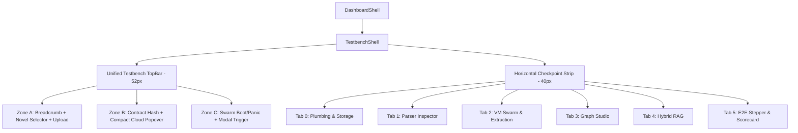

# Scriptoria Pipeline Testbench: Master Navigation & 6-Page Layout Re-Plan

**Author:** Antigravity Architect & AI Studio Argon (`gemini-4-argon`)  
**Target:** Unified Single-Header Navigation & Responsive 6-Page Studio Layout  
**Date:** 2026-11-16  

---

## 1. Executive Summary & Root Cause Analysis

### 1.1 The Core Problems in Current Layout
1. **Horizontal Header Overflow (1,716px required width):**
   - The current `TestbenchTopBar` places 13 distinct controls and status indicators in a single horizontal row: Book dropdown (300px), status badge (120px), upload button (80px), contract hash badge (180px), trace ID (140px), refresh button (36px), R2 pill (140px), Supabase pill (140px), Turso pill (140px), VM Swarm pill (120px), Manage Swarm (120px), and Boot Swarm button (140px).
   - On standard screens (1280px–1440px), this horizontally clips at `Supabase`, cutting off Turso, VM Swarm status, and the primary `Boot Swarm` button completely.
2. **Dual-Shell Navigation Friction:**
   - Having both the global application sidebar (`w-56` or `w-14`) and a second vertical testbench checkpoints rail (`w-48`) consumes over 400px of horizontal width before page content begins.
   - For 3-column test benches (Tab 1 Parser AST, Tab 2 3-column extraction, Tab 3 Knowledge Graph + Inspector, Tab 4 RAG 3-column inspector), this results in cramped, illegible columns.
3. **Double Header Artifact:**
   - `DashboardShell` outer header (`Pipeline Testbench (Checkpoints 0–5)`) stacked on top of `TestbenchTopBar` created an unnecessary double navbar.

---

## 2. Unified Navigation Architecture

### 2.1 The Single-Header Solution (Height: 52px, Zero Clipping)
The new top navigation bar consolidates all controls into three distinct, responsive zones:

```
┌────────────────────────────────────────────────────────────────────────────────────────────────────────┐
│ [Logo] Scriptoria / Testbench  [Moby Dick ▾] [PARSED] │ [f92dac5e Verified] [Cloud 4/4 ▾] │ [⚡ Boot Swarm] [Upload] │
└────────────────────────────────────────────────────────────────────────────────────────────────────────┘
```

#### Zone A (Left — Context & Book Scope, ~320px)
- **Brand / Breadcrumb:** `Scriptoria / Testbench` with mobile menu trigger.
- **Novel Selector Dropdown:** Compact, truncated selector (max 220px) with inline status badge (`PARSED 147 CH`).
- **Quick Upload Novel Button (`+`)**.

#### Zone B (Center — Engine & Infrastructure Telemetry, ~280px)
- **Contract Parity Pill:** `Contract Hash: f92dac5e (Verified)` with green shield.
- **Unified Cloud Cluster Popover (`[Cloud Lake: 🟢 4/4 Ready ▾]`):**
  - Replaces 5 separate wide pills (R2, Supabase, Turso, VM Swarm, Trace) that previously took up 700px!
  - Clicking or hovering this compact badge opens a sleek dark-glass popover card displaying:
    - **Cloudflare R2 Storage Lake:** `55ms latency · 14 objects` (Bucket: `scriptoria-lake`).
    - **Supabase Catalog:** `Connected · 2 books registered`.
    - **Turso libSQL Database:** `Connected · 203ms latency`.
    - **VM Swarm:** `0/14 GPUs Online` with direct 1-click boot/kill triggers.
    - **Active X-Trace ID:** with 1-click clipboard copy.

#### Zone C (Right — Primary Action Controls, ~220px)
- **Cluster Control Button:** Dynamic button switching between:
  - `[⚡ Boot Swarm]` (when offline)
  - `[🛑 /vm-kill Panic]` (when online)
  - `[Starting (2/5)... Cancel]` (when booting)
- **Manage Swarm / Targets Dialog Trigger**.

> [!TIP]
> **Total Top Bar Width:** ~820px. Fits effortlessly on **any** viewport from 1024px tablet landscape up to 4K ultra-wide without horizontal clipping or scrollbars.

---

### 2.2 Checkpoint Navigation: Horizontal Tabstrip vs. Mini-Rail

To maximize usable width for the 6 test pages, Checkpoints 0 through 5 are placed in a **Horizontal Segmented Studio Tabstrip** (Height: 40px) pinned directly below the top bar:

```
┌────────────────────────────────────────────────────────────────────────────────────────────────────────┐
│ [0. Plumbing & Storage]  [1. Parser Inspector]  [2. VM Swarm]  [3. Graph Studio]  [4. Hybrid RAG]  [5. Scorecard] │
└────────────────────────────────────────────────────────────────────────────────────────────────────────┘
```

**Key Architectural Advantages:**
- **Zero Horizontal Waste:** Reclaims 192px–224px of horizontal space previously lost to the vertical checkpoint rail.
- **Full Viewport Width for Complex Checkpoints:** Enables deep 3-column workspaces for Tabs 1, 2, 3, and 4.
- **Status Badges Per Tab:** Each tab displays an inline status dot (🟢 Ready, 🟡 Ingesting, ⚪ Idle).

---

## 3. In-Depth Page Layout Blueprints (All 6 Test Pages)

### 3.1 Tab 0: Plumbing, Contracts & Storage Lake
* **Layout Anatomy:** 2-Column Responsive Workspace (`lg:grid-cols-12`).
  * **Col 1 (5 cols):** Novel Uploader (.epub / .pdf drag-and-drop) + R2 Scoped Tree Explorer (`raw/`, `parsed/`, `extracted/`, `compiled/`).
  * **Col 2 (7 cols):** 
    * Row 1: Live Infrastructure Smoke Test Cards (R2 roundtrip, Supabase query, Turso ping, Swarm probe).
    * Row 2: Schema Fault Injector & Contract Rejection Sandbox (EC-0.1 strictness testing with 3 instant fault triggers).
    * Row 3: Automated Pytest Harness Runner with real-time test runner terminal.

---

### 3.2 Tab 1: Deterministic Novel Parser Inspector
* **Layout Anatomy:** Full-Bleed 2-Column Dual-Inspector with Resizable Splitter.
  * **Top Bar (36px):** Profile selector (Fiction Standard / Strict / Raw), Sample Excerpt pills, Ligature Normalization switch (`fi`, `fl`, `ffi`), and "Run Parser Inspector" trigger.
  * **Left Column (50%):** Interactive Document AST Explorer:
    * Segmented tabs: `[Document Tree (AST)]` | `[Chunks (N)]` | `[Diagnostics]`.
    * Hierarchical tree view showing Chapters, Scenes, and Paragraphs with codepoint & UTF-16 offset badges.
  * **Right Column (50%):** Synchronized Dual-Span Text Viewer:
    * Text highlighting synchronized with selected AST node or chunk boundary.
    * Character offset counter showing exact `[start, end]` ranges and astral surrogate pair detection.

---

### 3.3 Tab 2: VM Swarm & 3-Column Extraction Inspector
* **Layout Anatomy:** 3-Column Live Streaming Pipeline (`grid-cols-1 lg:grid-cols-3 gap-4`).
  * **Column 1 (Input Chunk):** Raw text window with 120-character verbatim quote anchor highlights and chapter metadata.
  * **Column 2 (Live LLM Stream):** Streaming terminal displaying live token emission from Kaggle VM Qwen 2.5 14B workers, speed gauge (tokens/sec), and prompt payload inspector.
  * **Column 3 (Structured Extraction Inspector):** Discovered characters, outfit deltas, setting environment clues, visual beats, and simulated network crash/recovery fault injector (EC-2.4).

---

### 3.4 Tab 3: Stage-2 Compiler & Temporal Graph Studio
* **Layout Anatomy:** 2-Row Split Studio (`Top: Scrubber & Sub-Tabs`, `Bottom: Canvas & Inspector`).
  * **Row 1 (Sub-Navigation & Timeline):**
    * Dual Timeline Scrubber (EC-3.1): Story Clock vs. Narrative Clock with Flashback highlight isolation.
    * Studio Sub-Tabs: `[Dual Timeline]` | `[Character Tiers]` | `[Location Hierarchy]` | `[Interactive Graph Canvas]` | `[Item Custody]`.
  * **Row 2 (Interactive Canvas Workspace):**
    * Left / Center (8 cols): Interactive SVG Knowledge Graph with zoom, pan, node dragging, and co-occurrence edge filtering.
    * Right (4 cols): Detailed Entity & Location Inspector showing visual tier badges (Tier 1 Core, Tier 2, Tier 3), materialized location paths, and appearance timeline.

---

### 3.5 Tab 4: Hybrid RAG Workbench & Safe SQL Console
* **Layout Anatomy:** 2-Panel Workbench with Global Spoiler Shield.
  * **Top Control Bar:** Global Spoiler Shield Scrub Slider (EC-4.2) locking knowledge visibility to story tick $T$, and Safe Read-Only SQL query console with schema auto-complete.
  * **Panel A (Retrieval Inspector — 3 Columns):**
    * Sub-col 1: Lexical BM25 (SQLite FTS5) scored rankings.
    * Sub-col 2: Vector Semantic Search (DiskANN 768-dim bge-m3) similarity rankings.
    * Sub-col 3: Reciprocal Rank Fusion (RRF $k=60$) fused output with rank promotion badges.
  * **Panel B (Storage Budget & Graph Traversal):** 104.5 KB libSQL storage budget meter (EC-4.4) and 2-hop entity graph hop visualizer (EC-4.3).

---

### 3.6 Tab 5: E2E Pipeline Stepper & Automated QA Scorecard
* **Layout Anatomy:** Unified 2-Card Execution & Verification Dashboard.
  * **Card 1: 5-Stage Sequential Pipeline Orchestrator:**
    * Visual stepper for Stages 1–5: `1. Ingestion` $\rightarrow$ `2. Extraction` $\rightarrow$ `3. Compilation` $\rightarrow$ `4. Indexing` $\rightarrow$ `5. QC & Rendering`.
    * Live execution triggers with real-time stage progress bars and error recovery controls.
  * **Card 2: 15-Point Invariant Regression Scorecard:**
    * Comprehensive audit matrix verifying all invariants:
      * Plumbing: `EC-0.1` (Schema Strictness)
      * Parser: `EC-1.1` (Astral Code Points), `EC-1.2` (Ligatures), `EC-1.3` (Chunk Word Cap)
      * Extraction: `EC-2.1` (Quote Anchoring), `EC-2.2` (VRAM Eviction), `EC-2.3` (Worker Crash Resume), `EC-2.4` (Summary Bloat Cap)
      * Compiler: `EC-3.1` (Dual Timeline Flashbacks), `EC-3.2` (Visual Tier Registry), `EC-3.3` (Location Materialized Paths)
      * RAG: `EC-4.1` (RRF Fusion), `EC-4.2` (Global Spoiler Shield), `EC-4.3` (2-Hop Traversal), `EC-4.4` (104.5 KB Storage Cap)
    * Pass/Fail scorecard with automated 1-click test execution and JSON export.

---

## 4. Implementation Plan & Component Hierarchy


