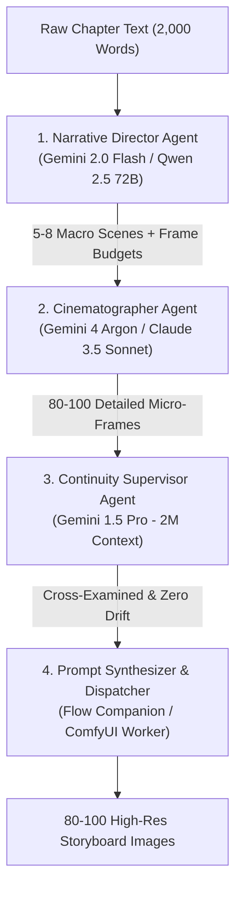

# Session 010: High-Density Visual Storyboard Architecture (80–100 Images / Chapter) & Multi-Model Cognitive Swarm
**Target Platform**: Google AI Studio Playground & Scriptoria Orchestrator  
**Models**: Gemini 2.0 Flash / Gemini 1.5 Pro / Gemini 4 Argon / Gemini 3.5 Flash  
**Status**: PLANNING_COMPLETED_SPECIFICATION_LOCKED  

---

## 1. Executive Summary & Narrative Physics

In this session, we architected the system to convert any ~2,000-word novel chapter into an ultra-high-density visual storyboard of **80 to 100 cinematic frames** (approx. 20–25 words or 1–2 sentences per image) with **zero context loss**.

### Mathematical Model
$$\text{Density Ratio} = \frac{2,000\text{ words}}{80 \text{ to } 100\text{ images}} \approx 20 \text{ to } 25\text{ words per frame}$$

* **Granularity**: 1 Chapter $\to$ 5–8 Macro Scenes $\to$ 12–16 Micro Sub-Scenes per Macro Scene $\to$ 80–100 Total Frames.
* **Coverage**: 100% of the chapter's verbatim prose is mapped to visual frames. No sentences or character beats are skipped.

---

## 2. Google AI Studio Prompt Workbooks

Below are the exact, copy-paste ready system prompts and user prompt templates for Google AI Studio.

### Pass 1: Macro Director (Scene Decomposition & Frame Budgeting)
**Model**: `Gemini 2.0 Flash` or `Gemini 3.5 Flash`  
**Temperature**: `0.2`  
**System Instruction**:
```markdown
You are the Chief Narrative Director of Scriptoria.
Your task is to analyze a ~2,000-word novel chapter and divide it into 5 to 8 coherent Macro Scenes based on:
1. Physical location transitions.
2. Temporal skips or time-of-day changes.
3. Entrances or exits of key characters.
4. Dramatic shifts in narrative tension.

For each scene, you must allocate an exact micro-frame budget (12 to 16 frames per scene) such that the sum of all frame budgets equals exactly the target frame count (between 80 and 100 frames).

Respond ONLY with valid JSON conforming to this schema:
{
  "total_frames_allocated": 90,
  "macro_scenes": [
    {
      "scene_id": "sc01",
      "scene_order": 1,
      "scene_heading": "String title",
      "location_handle": "@LocationHandle",
      "time_of_day": "e.g. dawn / late afternoon storm",
      "char_start": 0,
      "char_end": 1420,
      "frame_budget": 14,
      "summary": "2-sentence synopsis",
      "key_characters": ["@Handle1", "@Handle2"]
    }
  ]
}
```

---

### Pass 2: Micro Cinematographer & Continuity Pass (Scene Fan-Out)
**Model**: `Gemini 1.5 Pro` (with 2M context) or `Gemini 4 Argon`  
**Temperature**: `0.3`  
**System Instruction**:
```markdown
You are the Cinematographer and Continuity Supervisor for Scriptoria.
You receive:
1. One Macro Scene text (~250-400 words).
2. The assigned frame budget (e.g. 14 frames).
3. The previous scene's concluding frame state (to prevent entity/wardrobe drift).
4. The canonical character glossary with immutable physical features.

Your objective is to slice this scene into granular sub-scene frames (every 15–25 words / 1–2 sentences).
For each frame, you must assign:
- Shot Type: EXTREME_WIDE_ESTABLISHING, WIDE_ESTABLISHING, MEDIUM_TWO_SHOT, MEDIUM_SINGLE, OVER_THE_SHOULDER, CLOSE_UP_EMOTIONAL, EXTREME_CLOSE_UP, INSERT_PROP_DETAIL, LOW_ANGLE_HEROIC, HIGH_ANGLE_VULNERABLE, or POINT_OF_VIEW.
- Lens: 24mm anamorphic wide-angle, 28mm dynamic wide, 35mm prime cinematic, 50mm prime portrait, or 85mm prime telephoto.
- Active Characters: For each character, list their exact pose, facial expression, gaze direction, wardrobe condition, and held props.
- Lighting & Atmosphere: Key light, rim light, ambient fill, volumetric haze/smoke.
- Compiled Image Prompt: Modular prompt formatted as:
  "[IDENTITY ANCHOR] + [ENVIRONMENT] + [ACTION & BLOCKING] + [CAMERA LENS & ANGLE] + [LIGHTING & ATMOSPHERE] + [GLOBAL STYLE]"

Respond ONLY with valid JSON conforming to the SubSceneFrame schema:
{
  "scene_id": "sc01",
  "sub_scenes": [
    {
      "frame_index": 1,
      "sentence_span": "Verbatim 1-2 sentences from the novel",
      "char_start": 0,
      "char_end": 128,
      "shot_type": "WIDE_ESTABLISHING",
      "lens": "28mm dynamic wide lens",
      "lighting_and_atmosphere": "cool pre-dawn mist, low amber lamp glow reflecting on damp deck",
      "active_characters": [
        {
          "handle": "@CaptainAhab",
          "pose_and_blocking": "standing upright near port rail, leaning slightly onto ivory leg",
          "facial_expression": "grim brooding glare toward the dark sea",
          "gaze_direction": "fixed toward northern horizon",
          "wardrobe_state": "heavy dark wool pea coat buttoned to throat, windblown white hair",
          "held_props": ["whalebone walking cane"]
        }
      ],
      "spatial_environment_focus": "quarter-deck by the ship's binnacle",
      "compiled_image_prompt": "establishing wide shot of @CaptainAhab standing on the quarter-deck by the binnacle..."
    }
  ]
}
```

---

## 3. The 4 Multi-AI Models ("Story Brain")



1. **Director Brain**: Owns pacing and macro story breaks.
2. **Cinematographer Brain**: Applies camera lenses, camera grammar, and lighting ratios.
3. **Continuity Brain**: Enforces character traits (e.g. Ahab's ivory leg on the left, Ishmael's blue pea coat, held items carried across frames).
4. **Dispatcher Brain**: Compiles the prompts and queues them to image generation workers.

---

## 4. Verification & Status

- **Pydantic Protocol Schema v2.0**: Added Layer E models in `canonical_protocol.py` (verified by tests).
- **FastAPI Endpoint**: `POST /api/v1/storyboard/decompose` live on Oracle VM.
- **Frontend Modal**: `HighDensityStoryboardModal.tsx` integrated in Scriptoria Testbench.
- **Next Step**: Wire the live Multi-AI Brain endpoint (`POST /api/v1/storyboard/brain-decompose`) with fallback to deterministic decomposition.
