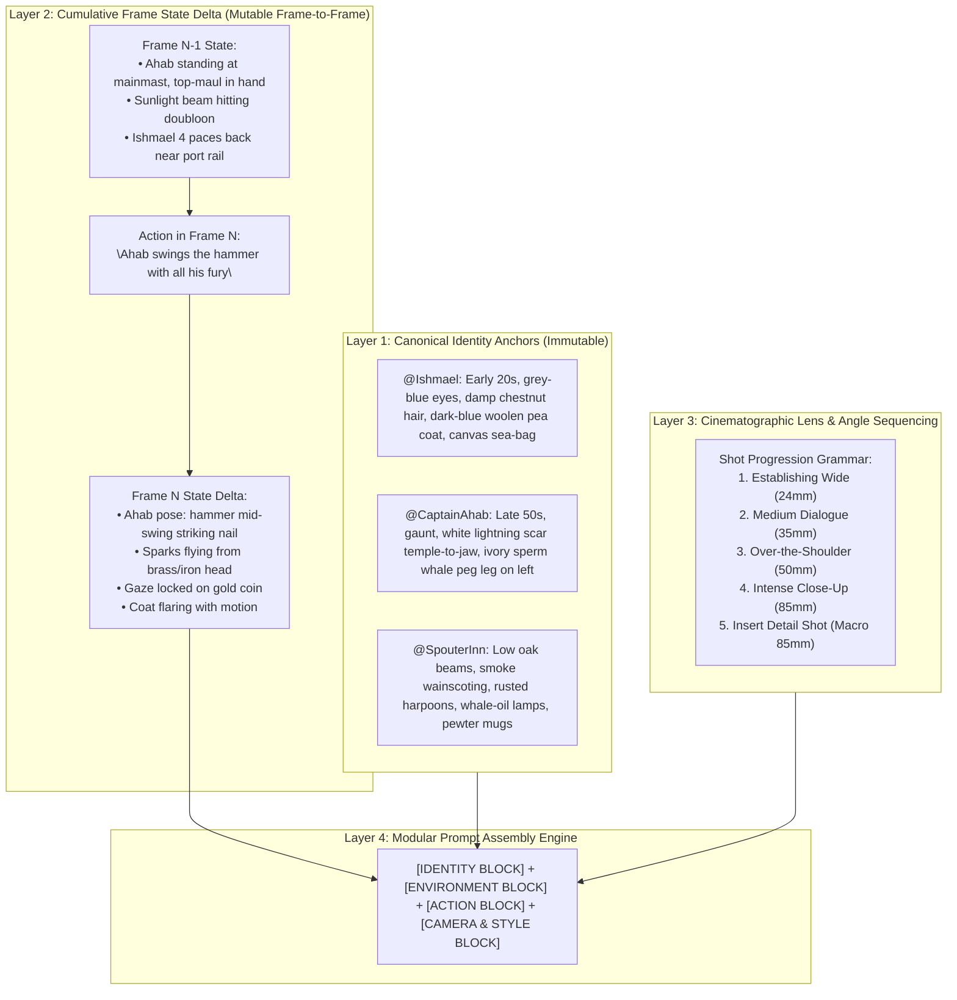

# SCRIPT CONTEXT SLICE: HIGH-DENSITY VISUAL STORYBOARD & 100-SHOT CONTINUITY ENGINE
## Target: Chief AI Architect & Multi-Model Director (Gemini 2.0 / 4 Argon / Hydrogen) via Google AI Studio
## Source Novel Specification: 2,000 Words / Chapter -> 80 to 100 Cinematic Visual Frames / Chapter
## Status: SPECIFICATION & MULTI-MODEL ORCHESTRATION BLUEPRINT

---

### 1. Mathematical Breakdown & Granularity Budget

For a standard literary fiction chapter of **~2,000 words**:

$$\text{Density Ratio} = \frac{2,000\text{ words}}{80 \text{ to } 100\text{ images}} \approx 20 \text{ to } 25\text{ words per image (sub-scene)}$$

| Hierarchy Level | Count per Chapter | Word Budget | Visual / Narrative Scope |
| :--- | :--- | :--- | :--- |
| **Level 1: Chapter** | 1 | ~2,000 words | Complete dramatic chapter arc, overarching themes, temporal progression. |
| **Level 2: Macro Scene** | 5 to 8 scenes | 250 to 400 words | Bounded by location shifts, time shifts, or entry/exit of characters. |
| **Level 3: Micro Sub-Scene** | 12 to 16 per scene (**80–100 total**) | **15 to 25 words (1–2 sentences)** | Granular cinematic visual beat: specific line of dialogue, physical gesture, prop pickup, camera pan, gaze shift. |
| **Level 4: Visual Shot Prompt** | 1 per Sub-Scene | N/A (Compiled Output) | Production-ready image generation prompt (Imagen 3 / Nano Banana / Flux / SDXL) with locked identity anchors. |

---

### 2. The 4-Layer Zero Context-Loss Architecture

Generating 80–100 prompts sequentially typically leads to **Entity Drift** (face changing), **Wardrobe Mutation** (clothes changing color), **Lighting Inversion** (day vs night flips), and **Spatial Teleportation** (characters swapping sides of the room).

Scriptoria eliminates this via four deterministic continuity layers:



---

### 3. Pydantic Contract v2.0: High-Density Chapter Schema

```python
from __future__ import annotations
from typing import List, Optional, Dict, Any
from enum import Enum
from pydantic import BaseModel, Field, ConfigDict

class ShotType(str, Enum):
    EXTREME_WIDE_ESTABLISHING = "EXTREME_WIDE_ESTABLISHING"  # 24mm
    WIDE_ESTABLISHING = "WIDE_ESTABLISHING"                  # 28mm
    MEDIUM_TWO_SHOT = "MEDIUM_TWO_SHOT"                      # 35mm
    MEDIUM_SINGLE = "MEDIUM_SINGLE"                          # 50mm
    OVER_THE_SHOULDER = "OVER_THE_SHOULDER"                  # 50mm
    CLOSE_UP_EMOTIONAL = "CLOSE_UP_EMOTIONAL"                # 85mm
    EXTREME_CLOSE_UP = "EXTREME_CLOSE_UP"                    # 85mm macro
    INSERT_PROP_DETAIL = "INSERT_PROP_DETAIL"                # 85mm macro
    LOW_ANGLE_HEROIC = "LOW_ANGLE_HEROIC"                    # 28mm low
    HIGH_ANGLE_VULNERABLE = "HIGH_ANGLE_VULNERABLE"          # 35mm high
    POINT_OF_VIEW = "POINT_OF_VIEW"                          # 35mm eye-level

class CameraLens(str, Enum):
    MM_24 = "24mm anamorphic wide-angle lens"
    MM_28 = "28mm dynamic wide lens"
    MM_35 = "35mm prime cinematic lens"
    MM_50 = "50mm prime portrait lens"
    MM_85 = "85mm prime telephoto lens"

class CharacterFrameState(BaseModel):
    model_config = ConfigDict(extra="forbid")
    handle: str = Field(..., description="Canonical handle e.g. '@CaptainAhab'")
    pose_and_blocking: str = Field(..., description="Physical stance, spatial positioning relative to camera and other entities")
    facial_expression: str = Field(..., description="Exact micro-expression (e.g. grim fury, dilated eyes, tense jaw)")
    gaze_direction: str = Field(..., description="Where eyes are focused (e.g. looking down at the nail on the mast)")
    wardrobe_state: str = Field(..., description="Active state of clothing (e.g. coat whipping in wind, salt-crusted, unbuttoned)")
    held_props: List[str] = Field(default_factory=list, description="Items held in hand during this frame")

class SubSceneFrame(BaseModel):
    model_config = ConfigDict(extra="forbid")
    frame_index: int = Field(..., ge=1, le=120, description="Sequential frame number in chapter (1 to 100)")
    scene_id: str = Field(..., description="Parent macro scene identifier e.g. 'sc01'")
    sentence_span: str = Field(..., description="Verbatim 15-25 word excerpt from the novel text")
    char_start: int = Field(..., ge=0, description="Character offset start in chapter markdown")
    char_end: int = Field(..., ge=0, description="Character offset end in chapter markdown")
    shot_type: ShotType = Field(..., description="Cinematographic shot grammar")
    lens: CameraLens = Field(..., description="Focal length")
    lighting_and_atmosphere: str = Field(..., description="Exact lighting key, rim, direction, and atmospheric particles")
    active_characters: List[CharacterFrameState] = Field(..., description="Characters visible in frame with posture/gaze")
    spatial_environment_focus: str = Field(..., description="Specific zone of the location in view")
    compiled_image_prompt: str = Field(..., description="Complete production prompt formatted for Imagen 3 / Nano Banana / Flux")

class MacroScene(BaseModel):
    model_config = ConfigDict(extra="forbid")
    scene_id: str = Field(..., description="Unique scene ID e.g. 'sc01'")
    scene_order: int = Field(..., ge=1, description="Order of macro scene in chapter")
    scene_heading: str = Field(..., description="Narrative heading e.g. 'The Golden Doubloon on the Mast'")
    location_handle: str = Field(..., description="Canonical location e.g. '@PequodQuarterDeck'")
    time_of_day: str = Field(..., description="e.g. 'late afternoon brewing storm'")
    summary: str = Field(..., description="2-3 sentence narrative summary")
    sub_scenes: List[SubSceneFrame] = Field(..., min_length=10, max_length=20, description="12-16 micro-frames per scene")

class HighDensityChapterStoryboard(BaseModel):
    model_config = ConfigDict(extra="forbid")
    book_id: str
    chapter_index: int
    chapter_title: str
    total_words: int
    total_frames: int = Field(..., ge=80, le=100, description="Guaranteed 80 to 100 frames total")
    scenes: List[MacroScene] = Field(..., min_length=4, max_length=8)
```

---

### 4. AI Studio Two-Pass Prompting Strategy

When orchestrating in Google AI Studio (using Gemini 2.0 / 4 Argon with 2M context window), generation is split into two specialized passes to guarantee high detail without token truncation:

#### Pass 1: The Macro Director Pass
- **Input**: The full 2,000-word chapter + Canonical Entity Tray (`@Ishmael`, `@Ahab`, etc.).
- **Task**: 
  1. Identifies the 5 to 7 logical Scene Transitions based on space, time, and dramatic pacing.
  2. Assigns each scene an estimated frame budget (e.g. Scene 1 = 14 frames, Scene 2 = 16 frames... total = 90 frames).
  3. Outputs the `MacroScene` array with character arrival/departure tags.

#### Pass 2: The Micro Storyboard Artist Pass (Per Scene Fan-Out)
- **Input**: 1 Macro Scene text (~300 words) + preceding frame state + Entity Anchors.
- **Task**:
  1. Walks the text sentence-by-sentence (every 15–25 words).
  2. Assigns shot type (Wide $\to$ Medium $\to$ Close-up $\to$ Insert).
  3. Computes the continuity delta from Frame $N-1$ to Frame $N$.
  4. Generates the final compiled 80–100 word image prompt.

---

### 5. Multi-AI Models Architecture ("The Brain to Think on Story Goes")

```mermaid
flowchart TD
    subgraph BRAIN ["Multi-AI Model Storyboard Swarm"]
        direction TB
        M1["Model 1: Narrative Director\n(Gemini 2.0 Flash / Qwen 2.5 72B)\nRole: Macro Pacing & Dramatic Arc"]
        M2["Model 2: Cinematographer\n(Gemini 4 Argon / Claude 3.5 Sonnet)\nRole: Camera Grammar, Lens, Lighting Ratios"]
        M3["Model 3: Continuity Supervisor\n(Gemini 1.5 Pro 2M Context)\nRole: Cross-Frame Wardrobe, Scars & Prop Latch"]
        M4["Model 4: Prompt Compiler & Dispatcher\n(Kaggle Dual-T4 / Google Flow Companion)\nRole: Imagen 3 / Nano Banana / Flux Generation"]
    end

    ChapterText["Raw Chapter (2,000 Words)"] --> M1
    M1 -->|6-8 Macro Scenes| M2
    M2 -->|80-100 Micro Frames| M3
    M3 -->|Verified Frames (Zero Drift)| M4
    M4 -->|Batch Execution| GeneratedGallery["80-100 High-Res Storyboard Images"]
```

1. **Director Brain**: Owns the story progression. Ensures the 80–100 images tell a cohesive narrative story without stalling or repeating static poses.
2. **Cinematographer Brain**: Applies authentic film theory (rule of thirds, leading lines, high-contrast chiaroscuro, lens depth-of-field).
3. **Continuity Brain**: Serves as the strict "script supervisor" on a movie set. Verifies that Ahab's ivory peg leg remains on the left leg, that Ishmael's jacket doesn't turn red, and that props picked up in Frame 12 are still held in Frame 13.
4. **Dispatcher Brain**: Directs prompts to the image generation backend (Google Flow Browser Extension, ComfyUI on Kaggle GPUs, or local API).
